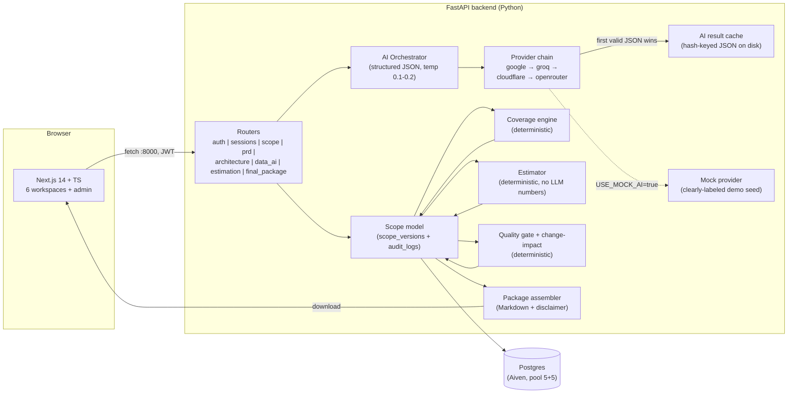

# AI Deal Scoping Assistant — Submission Architecture

## System Overview

## Request Lifecycle (happy path: missing-info scenario, live Gemini)

1. **Create session** `POST /sessions` → `sessions` row (status `in_progress`).
2. **Ingest** `POST /sessions/{sid}/ingest` (text or PDF/DOCX/TXT via pypdf/python-docx) → normalized markdown, chunked 1500/150-offset, stored in `documents` + `storage/{sid}.md`.
3. **Analyze** `POST /sessions/{sid}/analyze` → orchestrator sends `extract_v1` prompt → chain returns structured scope JSON → Pydantic validation (tolerant normalizers remap semantic IDs, stringify dict-valued fields) → `scope_versions` row v1 (`analyzed`), `audit_logs` entry.
4. **Review/edit** `GET /sessions/{sid}/scope`, `PATCH /sessions/{sid}/scope/items` → every item edit creates a NEW version (approved ones are never overwritten).
5. **Approve** `POST /sessions/{sid}/approve` (architect/reviewer/admin) → status `approved`; all generation endpoints return 409 until this passes.
6. **Generate** `POST /sessions/{sid}/prd|architecture|data-ai` → separate generator prompts + Pydantic schemas (`prd_v1`, `arch_v1`, `data_ai_v1`), arch output validated against a 15-layer × 3-platform service catalog (off-catalog + missing-layer checks) → each merges into a new approved `scope_versions` payload.
7. **Estimate** `POST /sessions/{sid}/estimate` (body `{"config": {...}}`) → pure-Python deterministic: workstreams from capabilities/integrations/AI, effort ranges from complexity drivers, `ROM = effort × rates × (1 + contingency)`; missing inputs lower confidence and are surfaced — never silently defaulted.
8. **Change impact** `POST /sessions/{sid}/change-impact` → recomputes links req→capabilities→arch→workstreams→ROM; affected/unaffected report.
9. **Quality gate** `POST /sessions/{sid}/quality-gate` → deterministic checks (coverage%, uncovered reqs, unsupported additions, unjustified arch components, plan-missing integrations, AI governance, missing estimate inputs, unresolved questions, conflicts, assumptions needing validation).
10. **Export** `POST /sessions/{sid}/package` → single Markdown artifact with mandatory disclaimer; `GET` re-downloads (e.g. `backend/storage/17be6d49..._scoping_package.md`).

## Grounding hierarchy (enforced in code)

| Tier | Source | Where enforced |
|---|---|---|
| Primary | Customer requirements (source-text mapped, traceable IDs) | extractor prompt + `normalize_ids` + source-chunk provenance |
| Secondary | User-reviewed assumptions/config | `PATCH scope/items`, estimate `config` body, approve gate |
| Tertiary | AI recommendations (labeled) | generator schemas keep `origin`/`rationale`; quality gate flags unsupported additions |

## Reliability mode (freemium)

- Chain order configurable via `AI_PROVIDER_CHAIN` (default `cloudflare,openrouter,groq,google`; repo `.env` uses `google,groq,cloudflare,openrouter`).
- First provider returning valid JSON wins; cache dedupes identical prompts (hash = prompt version + payload hash + provider + model).
- `USE_MOCK_AI=true` swaps the orchestrator to the deterministic mock provider — same flow, schemas, traceability — and `/health` reports `mock_mode: true` so runs are never confused with live mode.
- If every live provider fails, the error surfaces with provider/model trace (see `services/ai/live_json.py`).

## Data protection

- JWT auth (HS256), role-based endpoints (7 roles), audit log for every mutating action.
- Customer content stored in Postgres + local `storage/` only; sent to providers only when live mode is explicitly configured.
- `.env` is git-ignored; `.env.example` carries placeholders.

## Current limitations

- Markdown export only (PDF/DOCX bonus, not implemented).
- Mermaid diagrams rendered client-side as raw text/code preview (visual renderer pending).
- `change-impact` recomputation is graph-based on the latest approved version — hyper-targeted partial regeneration recomputes following stages deterministically.
